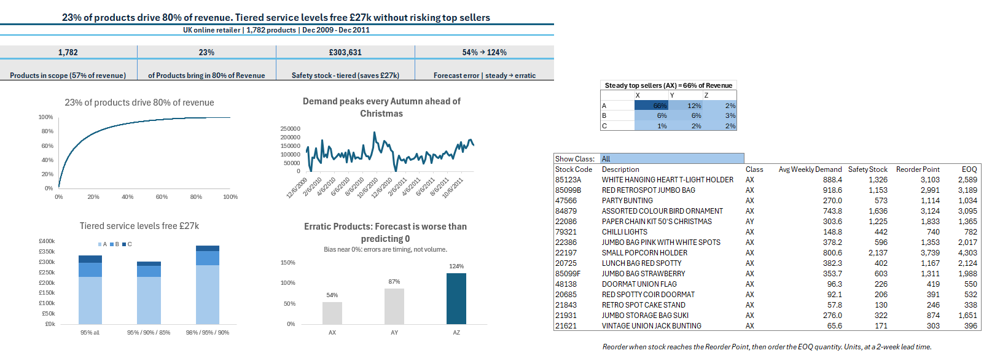

# Inventory Policy & Demand Analysis - Excel



This project was designed to practice the work a supply chain analyst regularly does including working with messy transaction data, determining which products matter, measuring how predictable the demand is, and turning that into reorder settings someone could actually use. Everything is done in Excel, using Power Query for the cleaning and formulas for the analysis.

## The Business Question

I framed the project around an inventory manager at a UK online gift retailer. I wanted to answer three things when looking at the thousands of products they have in stock:

1. Which products drive the business?
2. How predictable is demand for each product?
3. What safety stock, reorder point and order quantity should each product have, and where is money tied up?

## The Data

[Online Retail II](https://archive.ics.uci.edu/dataset/502/online+retail+ii) from the UCI Machine Learning Repository (CC BY 4.0, by Daqing Chen). It's real transaction data from a UK online retailer whose customers are mostly wholesalers.

- 1,067,371 order transaction rows | Dec 2009 – Dec 2011
- Columns: invoice, product code, description, quantity, date, price, customer ID, country
- No inventory levels and no cost data. Reorder settings are calculated from demand.

The raw file is 43.5 MB, so it isn't in this repo. Download it from the link above.

## The Process

| Step | Tab | What it does |
| --- | --- | --- |
| 1 | Power Query | Combined both years ('09 - '10 & '10 - '11), cleaned the data, and rolled it up to weekly units per product |
| 2 | Assumptions | Each input lives here as a named cell: lead time, different service levels, order and holding costs, class cutoffs. Change one and the whole workbook updates |
| 3 | SKU_Summary | One row per product. Total units, revenue, average weekly demand, demand variability |
| 4 | ABC_XYZ | Ranked products by revenue (ABC) and the demand variability (XYZ) |
| 5 | Inventory_Policy | Safety stock, reorder point and order quantity (EOQ) for each product, as well as a what-if table comparing service level policies |
| 6 | Forecast_Accuracy | Tested a 4 week moving average forecast on the top 10 products in AX, AY, and AZ |
| 7 | Dashboard | The page with findings and a reorder table you can filter by class |

## Key Findings

**1. A small piece of the product range drives most revenue.** 23% of products (403 products) bring in 80% of revenue. A typical Pareto shape expected in retail data.

**2. The range turns over a lot.** Only 1,782 of 4,703 products sold consistently across the entire date range ('09 - '11). Those products make up 57% of revenue. The rest are either seasonal, new launches, or discontinued products. I mainly focused the inventory analysis on the consistent products since that's where ongoing reorder decisions matter.

**3. The best sellers are also most predictable.** By normal industry standards, most of the demand is erratic with a median variability of 2.0. Makes sense for a wholesaler with a big Christmas peak, as was shown by the weekly chart. But compared with each other, the top sellers are the steadiest products this business has. Simply put, the high-value and steady group (AX) brings in 66% of revenue.

**4. Safety stock isn't spread efficiently.** With a 95% service level for everything, lower value C items tie up almost 2x the safety stock as their share of revenue.

| Service level policy (A / B / C) | Safety stock value |
| --- | --- |
| 95% / 95% / 95% (same for all) | £331,062.89 |
| **95% / 90% / 85% (tiered)** | **£303,630.76** |
| 98% / 95% / 90% | £380,034.38 |

Tiering the service level by class frees around **£27k** without reducing protection on the A items that bring in 80% of revenue. Raising A items to 98% costs more than the extra protection is likely worth.

**5. Weekly forecasts are noisy, but not biased.** A moving average missed by 54% on the steadiest top sellers and 124% on the erratic ones. Over 100% means the forecast was worse than just predicting zero. But bias was close to zero for every group (-3.1% / -3.6% / -1.0%), so the forecast gets total volume about right. Timing is the issue and we can't predict which week a big order will be made.

## Recommendations

1. **Set service levels by class** (95% / 90% / 85%). It frees about £27k with no change to the products that matter most.
2. **Automate replenishment for AX products.** They represent most of the revenue and are the most predictable.
3. **Plan volume monthly or by category, and let safety stock cover the weekly variation.** Product level weekly forecasts aren't reliable to plan from them alone.
4. **Review the erratic low-value products (CZ).** Could simply be set to order only when a customer order comes in, or cut altogether.

## Cleaning Steps

| Step | Rows affected | Why |
| --- | --- | --- |
| Removed cancellations (invoice starting with "C") | 19,494 | Reversed orders aren't demand |
| Removed quantity ≤ 0 and price ≤ 0 | overlaps with the above | Returns, write-offs, free items, bad debt adjustments |
| Removed fee and adjustment codes (postage, bank charges, manual entries, gift vouchers, tests) | 6,093 flagged | Not products. I reviewed every flagged code by hand and kept the DCGS codes, which turned out to be real products |
| Kept rows with no customer ID | 243,007 kept | The sale still happened. You'd drop these for customer analysis, but not for demand |
| Removed duplicate rows | 33,303 | The two yearly sheets overlap in early December 2010, and some lines were exact duplicates |
| Removed large orders that were cancelled later | 5 of 28 orders over 5,000 units | The cancellation was removed but the original order was still there. The other 23 had no cancellation, so they're real wholesale orders and stayed in |
| Standardized product codes to uppercase | 161 codes | Some codes appeared in both cases (e.g. 15056BL and 15056bl), which split one product into two |
| Kept complete weeks only (6 Dec 2009 – 3 Dec 2011) | 104 weeks | Partial weeks at either end would distort weekly averages |

Final clean data: 972,161 transaction rows.

## Assumptions and limitations

- **Assumption - lead time of 2 weeks, order cost of £50 and a 25% yearly holding cost.** The data has no supplier or cost info. In a real job I'd measure lead time from purchase order data and get the cost figures from finance.
- **Assumption - prices in pounds (£).** The retailer is UK based, but the dataset doesn't state a specific currency.
- **Limitation - inventory values use selling price, not cost.** No cost data, so the real money tied up would be lower than shown.
- **Assumption - weeks with no sales count as zero demand.** I calculated variability from sums and sums of squares so zero weeks are included without creating thousands of extra rows.
- **Decision - XYZ uses relative cutoffs.** The standard cutoffs (0.5 / 1.0) put 89% of products in the "erratic" group, which doesn't help tell them apart. I split products into thirds by variability instead.
- **Assumption - safety stock formula assumes smooth bell shaped demand.** A rough fit for very erratic products and for Christmas peaks. A real system would recalculate settings by season.
- **Limitation - the forecast test uses 30 products,** top 10 A products from each of AX, AY and AZ, not the full range.

## Switching Datasets Logic

I started this project on a synthetic Kaggle dataset. While working I noticed every product looked almost identical: 78 of 100 products were needed to reach 80% of revenue, every product had the same demand variability, and days of supply only ranged from 1.8 to 2.1 days. No product, store, season or promotion stood out, so it couldn't answer any real world-like business questions. So I simply switched to real data and kept the same workbook design.

## Skills Used

Power Query (appending, filtering, merges including anti joins, Group By, working past Excel's row limit with connection-only queries) · dynamic array formulas (FILTER, SORTBY, UNIQUE, XLOOKUP, SCAN, TAKE, CHOOSECOLS) · SUMIFS / COUNTIFS / AVERAGEIFS · named ranges and data validation · what-if Data Tables · charts and dashboard design

## What Next

- Recalculate safety stock by season instead of using one yearly average
- Try a forecasting method built for lumpy demand, and compare it with the moving average
- Add real lead times and costs if available

## Repository Structure
Power Query points to local file paths. To refresh, download the data and update the source under Data → Get Data → Data Source Settings.

```
├── README.md
├── data/
│   └── retail_inventory_data.csv
├── images/
│   └── dashboard.png
├── workbooks/
│   ├── retail_inventory_v1_synthetic.xlsx
│   └── inventory_analysis_project.xlsx
```

- `workbooks/inventory_analysis_project.xlsx`: the full workbook. Open the **Dashboard** tab first, and use the class dropdown to filter the reorder table.
- `images/dashboard.png`: dashboard screenshots